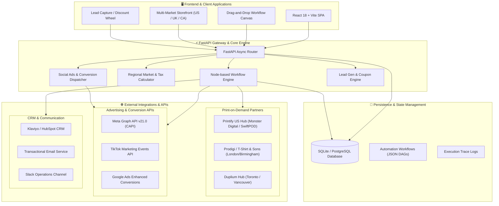

# PrintFlow Global: E-Commerce & POD Marketing Automation Architecture
## Designed for USA, United Kingdom, and Canada Markets

This document outlines the end-to-end technical architecture of **PrintFlow Global**, a scalable Print-on-Demand (POD) e-commerce system coupled with social media advertising conversion tracking (Meta CAPI, TikTok Events, Google Ads), automated lead generation pipelines, and an interactive React-based drag-and-drop workflow automation engine.

---

## 1. High-Level Architecture Diagram



---

## 2. Multi-Market Strategy: USA, UK & Canada

To maximize conversions and maintain competitive margins, the system routes orders to regional fulfillment hubs rather than shipping internationally:

| Feature | United States (🇺🇸) | United Kingdom (🇬🇧) | Canada (🇨🇦) |
| :--- | :--- | :--- | :--- |
| **Primary Currency** | USD (`$`) | GBP (`£`) | CAD (`CA$`) |
| **Exchange Rate Baseline** | 1.00 USD | ~0.79 GBP | ~1.38 CAD |
| **Tax Mechanism** | State Sales Tax (Dynamic avg 7.5%) | 20% Standard VAT | GST (5%) + Provincial HST/PST (13% avg) |
| **Base Shipping** | $4.99 USD | £3.99 GBP | CA$6.99 CAD |
| **Primary POD Partners** | Monster Digital (Detroit), SwiftPOD (San Jose) | Prodigi (Alton), T-Shirt & Sons (Westbury) | Duplium (Toronto), SwiftPOD Canada |
| **Domestic Couriers** | USPS Priority, FedEx Ground | Royal Mail Tracked 24/48, DPD | Canada Post Expedited, Purolator |
| **Customs / Tariffs** | Zero customs (Domestic US production) | Zero import VAT (Domestic UK printing) | Zero cross-border duty (Domestic CA printing) |

---

## 3. Social Media Ads & Conversion APIs Integration

In the modern privacy-first ecosystem (Apple iOS 14.5+ ATT), browser pixel cookies lose up to 40% of conversion events. PrintFlow implements **Server-Side Conversion APIs**:

### 3.1 Meta Conversions API (CAPI)
- **Endpoint**: Graph API v21.0 (`https://graph.facebook.com/v21.0/{PIXEL_ID}/events`)
- **Payload Construction**:
  - Automatically hashes user PII (`email`, `phone`, `country`) with SHA-256 before transmission.
  - Generates unique deterministic `event_id` to deduplicate browser pixel and server CAPI events.
  - Sends high-intent events: `Purchase`, `Lead`, `AddToCart`, `InitiateCheckout`.

### 3.2 TikTok Events API & Google Ads Enhanced Conversions
- **TikTok Events API**: Server-to-server tracking linking TikTok Click ID (`ttclid`) with purchase amount and currency.
- **Google Ads Enhanced Conversions**: Sends hashed first-party user identifiers for accurate Smart Bidding and ROAS attribution.

### 3.3 Inbound Lead Webhook Receiver
- Endpoint: `POST /api/ads/webhook/meta-lead`
- Listens for Meta Instant Forms / Facebook Lead Ads webhooks.
- Immediately assigns a region-specific discount code (e.g., `USA15OFF-415`, `UK20OFF-891`).
- Instantly fires the `lead_generated` automation workflow.

---

## 4. Visual Drag-and-Drop Workflow Automation Engine

The backend workflow engine interprets Directed Acyclic Graphs (DAGs) constructed directly in the React frontend:

### 4.1 Node Categories
1. **Triggers**:
   - `order_placed`: Triggered whenever a customer completes checkout.
   - `lead_generated`: Triggered when an ad lead arrives or a storefront popup is submitted.
   - `cart_abandoned`: Triggered when a shopper abandons a session.
2. **Conditions**:
   - `filter_country`: Evaluates whether `target_country` equals `US`, `UK`, or `CA`.
   - `filter_order_value`: Branch based on whether `total_amount > threshold`.
3. **Actions**:
   - `pod_fulfill`: Auto-routes items to local manufacturing facility.
   - `meta_capi`: Dispatches server-to-server Purchase or Lead event to Meta.
   - `tiktok_events`: Transmits conversion to TikTok Events API.
   - `google_enhanced`: Posts conversion to Google Ads.
   - `send_email`: Sends tracking link or regional discount coupon.
   - `crm_sync`: Tags customer in Klaviyo and HubSpot.
   - `slack_alert`: Pushes alert to ops team Slack channel.

---

## 5. Directory Structure

```
pod-ecommerce-platform/
├── backend/
│   ├── app/
│   │   ├── config.py             # Market settings (US, UK, CA), tax & currencies
│   │   ├── database.py           # SQLAlchemy SQLite / Postgres connector
│   │   ├── main.py               # FastAPI entrypoint, CORS & default seeds
│   │   ├── models/
│   │   │   └── models.py         # DB schemas (Product, Order, Lead, Workflow, Log)
│   │   ├── routers/
│   │   │   ├── ads.py            # Social Ads CAPI & Webhooks
│   │   │   ├── ecommerce.py      # Multi-market catalog & POD checkout
│   │   │   ├── leads.py          # Lead generation & CRM sync
│   │   │   └── workflows.py      # Drag-and-drop workflow CRUD & Simulation
│   │   ├── schemas/
│   │   │   └── schemas.py        # Pydantic validation models
│   │   └── services/
│   │       ├── lead_service.py   # Promo code generator & CRM hook
│   │       ├── pod_service.py    # POD routing engine (US, UK, CA hubs)
│   │       ├── social_ads_service.py # Meta CAPI, TikTok & Google Ads
│   │       └── workflow_engine.py    # Node-based graph execution engine
│   ├── requirements.txt
│   └── test_api.py               # Integration test suite
├── frontend/
│   ├── src/
│   │   ├── components/
│   │   │   ├── LogsViewer.jsx    # Real-time execution log audit
│   │   │   ├── MarketingHub.jsx  # Social Ads & Lead Gen dashboard
│   │   │   ├── Navbar.jsx        # Header, market switcher & tab nav
│   │   │   ├── Storefront.jsx    # POD catalog with dynamic currency
│   │   │   └── WorkflowCanvas.jsx# Visual Drag-and-Drop canvas
│   │   ├── App.jsx
│   │   ├── index.css
│   │   └── main.jsx
│   ├── package.json
│   ├── tailwind.config.js
│   └── vite.config.js
├── ARCHITECTURE.md
├── README.md
└── start.sh                      # Single-command localhost runner
```
